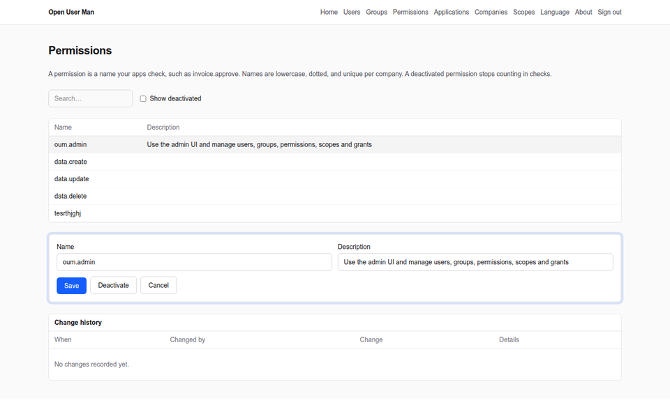
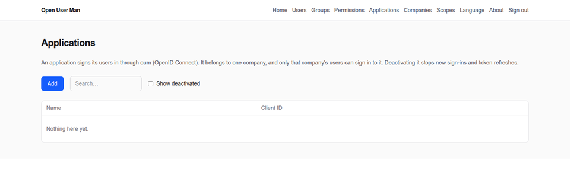
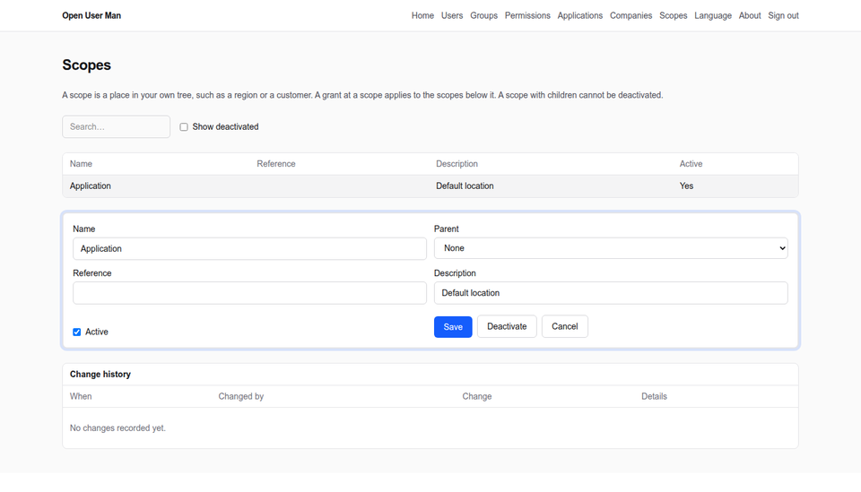

# Open User Man

Open User Man (`oum`) is a self-hosted service for managing **users**, **groups**, and **permissions**. A single NestJS process serves a REST API for the admin console and a gRPC API for your applications, backed by your own PostgreSQL or SQL Server database.

Here is the local admin console after signing in. It shows who holds which permissions, where each grant comes from, and the audit history behind every change.


## How it works

Administrators use the web console to create user accounts, organize users into groups, and grant or revoke permissions. Your applications do not query the database directly. Instead, they talk to `oum` over gRPC (`oum.v1`), or over REST with a bearer token if they only support HTTP.

- **One authorization question.** Permissions are dotted names you define, such as `invoice.approve`. You grant a permission to a user or a group, either company-wide or at a specific scope. Your application calls `Check` and gets a yes/no answer along with the exact grant that matched.
- **One process, two APIs.** The same NestJS server listens for REST on port `3001` and gRPC on port `5581`. The Next.js console uses JSON over REST, while backend services use protobuf over gRPC. The protobuf definitions in `packages/proto` serve as the shared contract.
- **Your own database.** Ready-to-run SQL scripts create eight tables in PostgreSQL or SQL Server. Every update and deletion is recorded in `users.audit_log` inside the same database transaction. Passwords are hashed with argon2id.
- **Ready-to-use client examples.** Working examples are included for C#, C++, Rust, Node.js, and curl. For any other language, generate a client directly from the `.proto` file.

Across the codebase, database schema, and UI, access rights are called **Permissions**.

## Inside the admin console

**Groups** are flat collections of users. A user automatically receives the grants of every active group they belong to.


**Permissions** are the capability names your applications check.



**Applications** are OpenID Connect clients that let users sign in through `oum`. A fresh local database starts with none registered.



**Scopes** form a tree that defines where a grant applies, such as application modules, customer areas, or physical locations like regions and buildings. A grant at a parent scope automatically covers every child scope beneath it (see [Scopes](docs/domain.md#scopes)). **Companies** represent tenants; multi-company filtering stays off until you enable it.

| Scopes | Companies |
| --- | --- |
|  |  |

The admin console stores the session in an `httpOnly` cookie named `oum_token` rather than in `localStorage`. Both English and Spanish interfaces are built in.

| Sign in | Language |
| --- | --- |
|  |  |

## Run locally

Prerequisites:

- Node.js 24 LTS (`>=24.21.0 <25`), matching `.nvmrc`
- pnpm 12 (see `packageManager` in `package.json`)

Install dependencies, generate the local environment files, and start the dev servers:

```bash
pnpm install
node scripts/write-local-env.mjs
pnpm dev
```

Open [http://localhost:3000](http://localhost:3000) and sign in with `admin` / `changeme`. Change this password before deploying to any shared environment. The REST API runs on port `3001` (with OpenAPI docs at `/api/docs`), and gRPC listens on port `5581`.

`write-local-env.mjs` creates the gitignored `.env` files with local defaults. Both the API and web app exit on startup if a required variable is missing. Keep `GRPC_API_KEY` separate from `JWT_SECRET`, and set `COOKIE_SECURE=true` only when serving over HTTPS. See [docs/environment.md](docs/environment.md) for the full variable reference.

## Calling oum from your application

Backend services should connect over gRPC. When `GRPC_API_KEY` is configured, pass it in the `x-api-key` metadata header. Call `Authenticate` to verify a user's credentials, then call `Check` to verify their permissions. Do not pass the admin session cookie to backend apps, and do not reuse `JWT_SECRET` as your gRPC API key.

If an application can only speak HTTP, call `POST /api/auth/token` with an account that holds the `oum.admin` permission, then send `Authorization: Bearer <token>` on requests to `/api/v1`. The session cookie returned by `POST /api/auth/login` is intended for the admin console.

| Language | Example | Transport |
| --- | --- | --- |
| C# (.NET, layered) | [`examples/csharp`](examples/csharp) | gRPC |
| C++ (CMake) | [`examples/cpp`](examples/cpp) | gRPC |
| Rust (tonic) | [`examples/rust`](examples/rust) | gRPC |
| Node.js | [`examples/grpc-client`](examples/grpc-client) | gRPC |
| curl + jq | [`examples/rest`](examples/rest) | REST bearer token |

Every example runs the same walkthrough: authenticate a user, check `oum.admin`, list the user's grants and all users, and ensure four sample permissions exist. New users have no permissions until you grant them. See [docs/integrate.md](docs/integrate.md) for the full integration flow.

## Self-hosting with Docker Compose

Start PostgreSQL, the API (`3001` HTTP, `5581` gRPC), and the web console (`3000`):

```bash
pnpm compose:up
```

To run with SQL Server instead of PostgreSQL, run `pnpm compose:up:mssql`. If port `5432` is already occupied on your machine, override it: `POSTGRES_HOST_PORT=5433 pnpm compose:up`.

You can deploy the **web** app to Vercel, but the NestJS API requires a long-lived host because it serves a persistent gRPC socket. See [docs/deploy.md](docs/deploy.md) for full deployment options.

## Repository layout

| Path | Description |
| --- | --- |
| `apps/api` | NestJS 12 backend serving HTTP and gRPC (`@oum/api`) |
| `apps/web` | Next.js 16 admin console (`@oum/web`) |
| `packages/proto` | Protobuf definitions and generated types (`@oum/proto`) |
| `packages/domain` | Shared domain enums and constants |
| `db/postgres`, `db/mssql` | SQL setup and seed packs for `open_user_db` |
| `examples/` | Integration examples in C#, C++, Rust, Node.js, and REST |
| `docs/` | Guides and reference documentation |
| `deploy/compose` | Docker Compose setup (`deploy/vercel` is web-only) |

For the contributor glossary and architecture summary, see [CONTEXT.md](CONTEXT.md).

## Security

The seeded admin account uses `admin` / `changeme`. Before exposing `oum` to a network, change that password, generate a strong `JWT_SECRET`, enable gRPC TLS, and configure `GRPC_API_KEY`. See [SECURITY.md](SECURITY.md) for the full checklist and vulnerability reporting instructions.

## Documentation

- [Guide](docs/guide.md) — visual walkthrough with diagrams covering architecture, initial setup, `Check`, SSO, and two-step verification
- [Domain](docs/domain.md) — core concepts: users, groups, permissions, grants, scopes, and `Check`
- [Database](docs/database.md) — the `users` schema and the PostgreSQL / SQL Server packs
- [gRPC](docs/grpc.md) — `oum.v1` services, TLS setup, and API key authentication
- [Integrate](docs/integrate.md) — how backend applications authenticate users and check permissions
- [Sign in with oum (OpenID Connect)](docs/sso.md) — SSO setup, client configuration, claims, two-step verification, and troubleshooting
- [Environment](docs/environment.md) — reference for all required and optional environment variables
- [Deploy](docs/deploy.md) — self-hosting with Docker Compose, cloud deployments, and Vercel

## Contributing and license

See [CONTRIBUTING.md](CONTRIBUTING.md). Licensed under the [MIT License](LICENSE).
