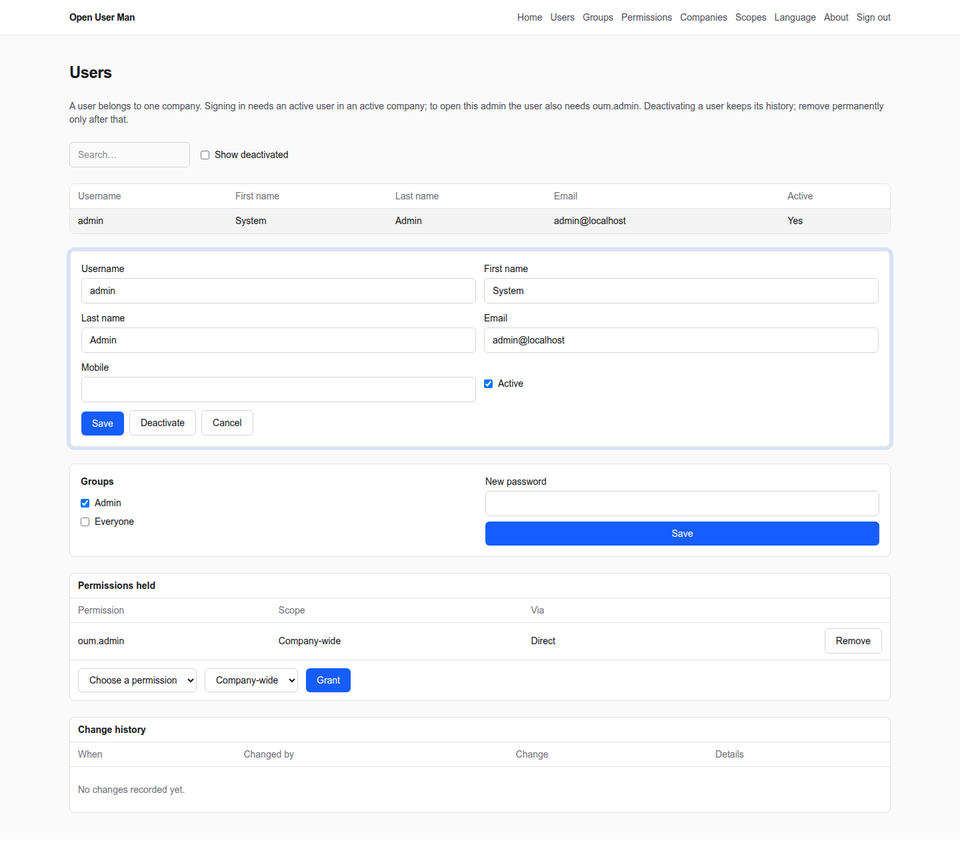
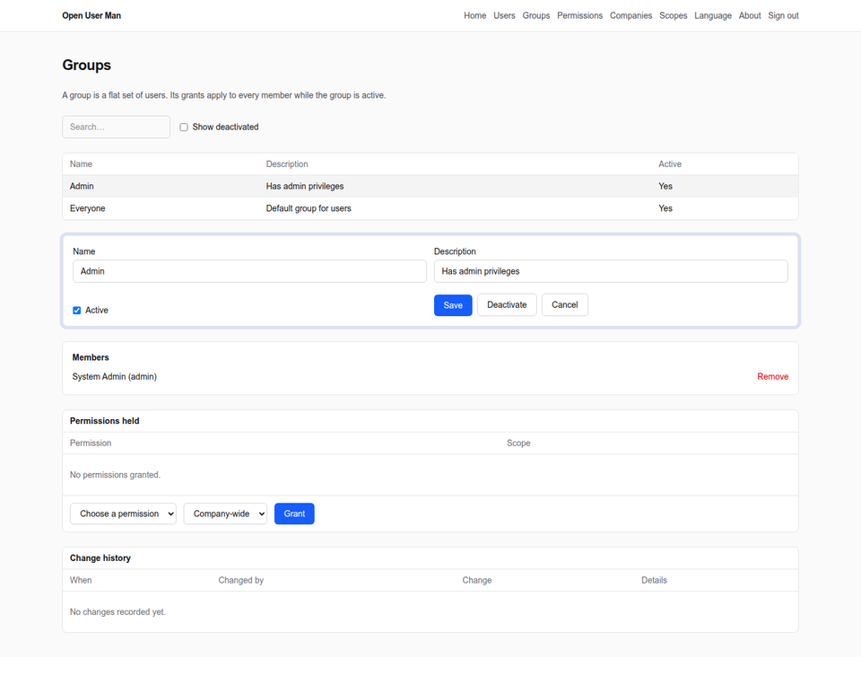
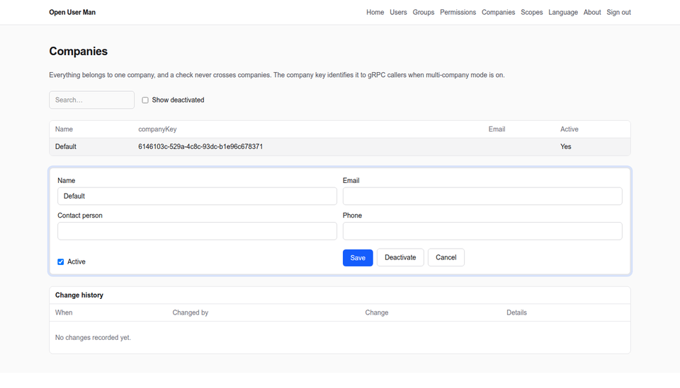
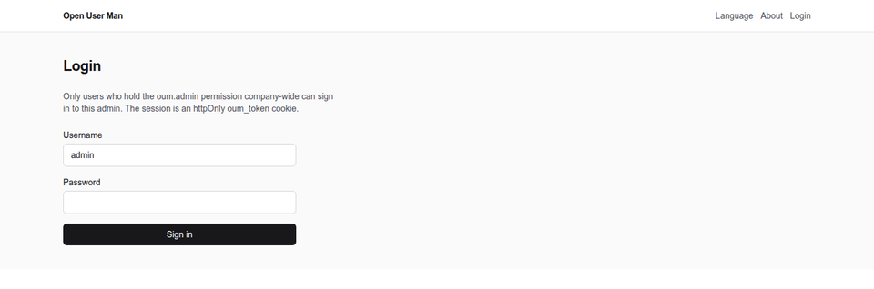
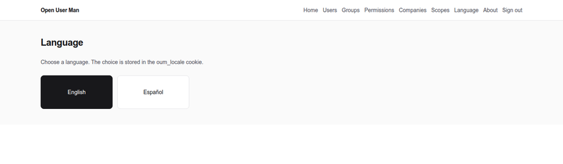

# Open User Man

Self-hosted **user, group, and permission** management. One NestJS process serves REST for the admin console and gRPC for the applications you already run. The database is yours: PostgreSQL or SQL Server, on your host, with no vendor tenant.

The console below is a local sign-in. It shows who can do what, where that right comes from, and the audit row behind the change.



## What it is for

An administrator opens the console to create accounts, put people in groups, and grant or revoke access rights. Integrating applications never scrape that database. They call the same service over gRPC (`oum.v1`) or, if they only have HTTP, REST with a bearer token.

- **One question: may this user do this here?** Permissions are free-form names such as `invoice.approve`. A grant gives one to a user or a group, company-wide or at a scope. Your app asks `Check` and gets the answer plus the grant that matched.
- **One process, two APIs.** REST on port 3001 and gRPC on port 5581. The Next.js UI speaks JSON. Your apps speak protobuf. Proto in `packages/proto` is the contract.
- **Your database.** SQL packs for PostgreSQL and SQL Server, eight tables. Every change except an insert is written to `users.audit_log` in the same transaction. Passwords are argon2id.
- **Clients you can copy.** C#, C++, Rust, Node, and curl. Any other language generates a client from the proto file.

Code, SQL and UI all say **Permission**.

## The console

Groups are flat sets of users. Members hold the grants of every active group they belong to.



Permissions are the names an application checks.


Scopes are a tree that says where a grant applies, and a grant covers everything below its scope: app parts, customer areas, or places such as regions and buildings (see [Scopes](docs/domain.md#scopes)). Companies are tenants. Multi-company filtering is off unless you turn it on.

| Scopes | Companies |
| --- | --- |
|  |  |

The session is an httpOnly `oum_token` cookie. The UI does not put the JWT in `localStorage`. English and Spanish are built in.

| Sign in | Language |
| --- | --- |
|  |  |

## Run it locally

- Node.js 24 LTS (`>=24.21.0 <25`), see `.nvmrc`
- pnpm 12 (`packageManager` in `package.json`)

```bash
pnpm install
node scripts/write-local-env.mjs
pnpm dev
```

Open [http://localhost:3000](http://localhost:3000) and sign in as `admin` / `changeme`. Change that password before any shared host. The API listens on `3001` (OpenAPI at `/api/docs`) and gRPC on `5581`.

`write-local-env.mjs` writes the gitignored env files. The API and web exit if a required variable is missing. `GRPC_API_KEY` is not `JWT_SECRET`. `COOKIE_SECURE=true` only behind HTTPS. Details: [docs/environment.md](docs/environment.md).

## Call it from your app

Integrating apps use gRPC. Send `x-api-key` when `GRPC_API_KEY` is set, `Authenticate` the user, then ask `Check` what they may do. Do not send the admin cookie, and do not reuse `JWT_SECRET` on gRPC.

Apps that only have HTTP call `POST /api/auth/token` (needs the `oum.admin` permission) and send `Authorization: Bearer` after that, using `/api/v1`. The cookie from `POST /api/auth/login` works for the console.

| Language | Sample | Transport |
| --- | --- | --- |
| C# (.NET, layered) | [`examples/csharp`](examples/csharp) | gRPC |
| C++ (CMake) | [`examples/cpp`](examples/cpp) | gRPC |
| Rust (tonic) | [`examples/rust`](examples/rust) | gRPC |
| Node | [`examples/grpc-client`](examples/grpc-client) | gRPC |
| curl + jq | [`examples/rest`](examples/rest) | REST bearer token |

Each sample authenticates a user, checks `oum.admin`, lists the user's grants and the users, and ensures four permissions exist. New users hold nothing until granted. Full handshake: [docs/integrate.md](docs/integrate.md).

## Self-host

```bash
pnpm compose:up
```

Postgres, the API (`3001` HTTP, `5581` gRPC), and the web app (`3000`). SQL Server instead: `pnpm compose:up:mssql`. If host port 5432 is taken, `POSTGRES_HOST_PORT=5433 pnpm compose:up`.

Vercel can host the **web** app only. The Nest process stays on a long-lived host. More: [docs/deploy.md](docs/deploy.md).

## Layout

| Path | What it is |
| --- | --- |
| `apps/api` | NestJS 12, HTTP + gRPC (`@oum/api`) |
| `apps/web` | Next.js 16 admin console (`@oum/web`) |
| `packages/proto` | protobuf source of truth (`@oum/proto`) |
| `packages/domain` | shared enums and constants |
| `db/postgres`, `db/mssql` | integrator SQL packs (`open_user_db`) |
| `examples/` | C#, C++, Rust, REST, Node |
| `docs/` | domain, database, gRPC, deploy, integrate |
| `deploy/compose` | self-host; `deploy/vercel` is web only |

Glossary and architecture: [CONTEXT.md](CONTEXT.md).

## Security

The seed admin is `admin` / `changeme`. Change it, set a strong `JWT_SECRET`, and enable gRPC TLS plus `GRPC_API_KEY` before exposing the service. See [SECURITY.md](SECURITY.md).

## Docs

- [Domain](docs/domain.md) — users, groups, permissions, grants, scopes, Check
- [Database](docs/database.md) — the `users` schema and the two SQL packs
- [gRPC](docs/grpc.md) — `oum.v1`, TLS, and the API key
- [Integrate](docs/integrate.md) — how another application signs a user in and calls Check
- [Environment](docs/environment.md) — every required variable
- [Deploy](docs/deploy.md) — Compose and Vercel

## Contributing and license

See [CONTRIBUTING.md](CONTRIBUTING.md). Licensed under the [MIT License](LICENSE).
