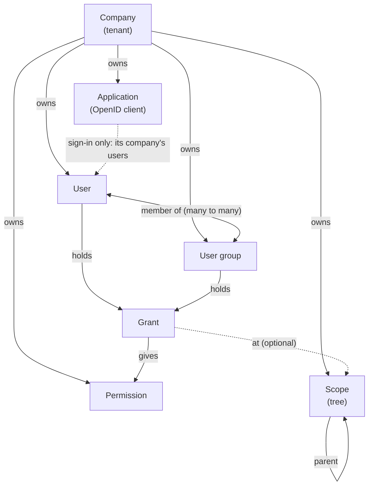

# Domain Model

Open User Man (`oum`) manages six core concepts: **users**, **user groups**, **permissions**, **scopes** (where a permission applies), **grants** (who holds which permission and where), and **companies** (tenants).

At runtime, your applications ask `oum` one question: *does this user hold this permission at this scope?* That lookup is called a **Check**.

## Data model

```
company ─┬─ user ──┬─ grant ── permission
         ├─ user_group ─┘        │
         │   └─ user_group_member (user ↔ group)
         ├─ permission           └── scope (optional; tree)
         └─ scope (tree)
```

| Concept | Description |
| --- | --- |
| **Permission** | A named capability such as `invoice.approve`. Names use lowercase dotted notation and are unique within a company. |
| **Scope** | A node in a hierarchy that defines where a grant applies. |
| **Grant** | Assigns one permission to one user **or** one user group, either at a specific scope or company-wide. |
| **User group** | A flat collection of users. Every active member inherits all grants assigned to the group. |

## Rules

1. **Sign-in only checks identity.** Authentication succeeds when the user exists, is active, is not deleted, belongs to an active company, and provides the right password (verified with argon2id). There is no special "can log in" permission. The admin console separately checks for the `oum.admin` permission, just like any other application check. Separating authentication from authorization lets any app reuse `oum` for sign-in.
2. **Groups are flat.** Groups cannot contain other groups. A user's effective permissions are their direct grants plus the grants of every active group they belong to. Keeping groups flat makes it straightforward to trace why a user has access.
3. **Scopes inherit downward.** A grant assigned at scope `S` applies to `S` and every descendant beneath `S`. A grant with no scope applies company-wide. For example, granting access at `Germany` automatically covers `Berlin` without listing every city.
4. **Checks without a scope match company-wide grants only.** If an application calls `Check` without specifying a scope, a grant restricted to `Berlin` will not satisfy it.
5. **Grants are allow-only.** `oum` has no deny rules. Access is either granted by a matching record or absent, which means every allowed decision can point to the exact grant that authorized it.
6. **Deactivated or deleted records have no effect.** Inactive or deleted users, groups, scopes, permissions, and companies are ignored during sign-in and `Check`. Deactivated records remain in the database (with `deleted_at` set) and can be reactivated later.
7. **Access never crosses company boundaries.** A `Check` only evaluates records within a single company. In multi-company mode, gRPC callers are restricted to the company specified in their `company-key` metadata header.

Every `Check` returns `allowed` (`true` or `false`). When `allowed` is `true`, the response also includes the matching grant (its ID, subject, and scope) so your app can audit or display why access was granted.

## How Users and Groups relate to Companies, Scopes and Applications



| Entity | Relation to **User** | Relation to **User group** |
| --- | --- | --- |
| **Company** | Each user belongs to one company, assigned at creation. The company must be active for the user to sign in or pass a `Check`. If the company enables **Require two-step verification**, its users must enroll before signing in. | Each group belongs to one company. |
| **Scope** | No direct link. Users are connected to scopes only through grants held directly or through their groups. | Same: groups are connected to scopes only through grants. |
| **Application** | No stored link. An application belongs to a company, and only users in that company can sign in to it. During sign-in, the app receives the user's profile, group names, and grants as claims; it does not store or modify them. | No stored link. The app receives the names of the user's active groups in the `groups` claim. |
| **Permission** | Reached through direct grants or group grants. | Reached through grants attached to the group. |

What this means in practice:

- **Strict company boundaries.** A user can only join groups in their own company. A grant's subject (user or group), permission, and scope must all belong to the same company, or the request is rejected.
- **Two additive paths to access.** A user holds their own direct grants plus the grants of every active group they belong to. Deactivating a group removes only the access that group provided.
- **Scopes define where, not who.** Users and groups never reference a scope directly. Instead, a grant ties together *permission + subject + scope*. Deactivating a scope or removing its grants changes where access applies without modifying user or group records.
- **Applications control sign-in, not authorization.** An application's OpenID token scopes (`openid`, `groups`, `permissions`) only determine which claims it may request. Use the returned claims or the gRPC `Check` API to decide what a user can do inside your app.
- **Setup order matters.** Create records in dependency order: company, then permissions and scopes, then users and groups, then group memberships and grants, and finally applications (see [guide.md](guide.md#first-run-set-oum-up-for-your-company)). Creating a user before its company, or a child scope before its parent, will fail.

## Scopes

A **scope** is a node in a tree that defines *where* a grant applies. While a permission answers "what can this user do?", a scope answers "where can they do it?".

You define the tree structure to fit your domain. The initial seed creates one root scope called `Application`, which cannot be deleted. Common tree structures include:

- **Application modules:** `Application` > `Billing`, `Reports`, `Admin`
- **Customer or tenant areas:** `Application` > `Customer A` > `Plant 1`
- **Geography:** `World` > `Europe` > `Germany` > `Berlin`

### Modeling locations with scopes

Scopes do not include built-in coordinates or map logic, so you model locations using the hierarchy itself:

1. Build a tree from broad to specific: region, country, city, building.
2. Store an external identifier in `reference` (such as an ISO code, site code, or `lat,lon`) and human-readable notes in `description`.
3. Grant permissions at the appropriate level, such as granting `ticket.close` to `Berlin technicians` at the `Berlin` scope.
4. When your app calls `Check`, pass the scope ID for the specific location. Because grants inherit downward, a grant at `Germany` automatically satisfies a `Check` at `Berlin` without needing to enumerate every child location.

In OAuth and OpenID Connect, the word "scope" refers to token permissions like `openid` or `email`. To avoid confusion, `oum` documentation and UI always call those **token scopes** and reserve **Scope** for this hierarchy.

## Deactivating and removing records

Companies, users, user groups, permissions, and scopes follow a two-step lifecycle for removal:

- **Deactivate** sets `active = false` and records a `deleted_at` timestamp. The record disappears from default list queries (pass `includeDeactivated` to include it) and can be restored later with **Activate**. Uniqueness constraints (usernames, keys, permission names) apply only to active rows, so reactivating a record can fail if another active record has since taken the same name. Deactivated permissions are ignored by `Check`, and a scope with active children cannot be deactivated.
- **Remove** permanently deletes a record. The record must be deactivated first, and nothing may still reference it (for example, a user or group with grants or memberships, a scope with children or grants, a company with child records, or a permission with grants). Otherwise, the request fails with a precondition error. Before deleting, `oum` writes a `remove` entry to `users.audit_log` containing a snapshot of the record (excluding password hashes), the actor, and the request source.

In REST, these actions map to `POST /v1/<resource>/:id/deactivate`, `POST /v1/<resource>/:id/activate`, and `DELETE /v1/<resource>/:id`. In gRPC, they map to `Deactivate<X>`, `Activate<X>`, and `Remove<X>`. Grants and group memberships are deleted immediately rather than deactivated, and those deletions are also recorded in the audit log.

If you are updating an existing database that lacks the permission lifecycle columns, run this migration (SQL Server uses the same structure on `[users].[permission]` with a filtered unique index):

```sql
ALTER TABLE users.permission ADD COLUMN active boolean NOT NULL DEFAULT true, ADD COLUMN deleted_at timestamptz;
ALTER TABLE users.permission DROP CONSTRAINT ux_permission_name;
CREATE UNIQUE INDEX ux_permission_name ON users.permission (company_id, name) WHERE deleted_at IS NULL;
```

## Multi-company mode

When `MULTI_COMPANY_MODE=true`, gRPC callers must send a `company-key` metadata header, and REST sessions are automatically scoped to the signed-in user's company. When multi-company mode is off (the default), all operations use the seeded default company.

## Audit log

Every update, deactivation, activation, and removal is written to `users.audit_log` inside the same database transaction as the change itself. Inserts are not logged, and password hashes are never written to the audit log.

Next: see [integrate.md](integrate.md) to learn how your application authenticates users and calls `Check`.
