# Guided Tour of oum

This guide walks through how the pieces of Open User Man (`oum`) fit together and the order in which to set them up. Each section includes a Mermaid diagram (rendered directly on GitHub) and links to the detailed reference page.

1. [The big picture](#the-big-picture)
2. [Choosing an integration path](#choosing-an-integration-path)
3. [First run: set oum up for your company](#first-run-set-oum-up-for-your-company)
4. [How access is decided (Check)](#how-access-is-decided-check)
5. [Sign in through oum (SSO)](#sign-in-through-oum-sso)
6. [What happens at the sign-in page](#what-happens-at-the-sign-in-page)
7. [Two-step verification](#two-step-verification)
8. [Changing and removing records](#changing-and-removing-records)
9. [Where oum runs](#where-oum-runs)

## The big picture

One NestJS process handles all traffic. The admin console communicates over REST, your backend services communicate over gRPC, and end users sign in to your web apps through the built-in OpenID Connect provider. Everything reads from and writes to a single database that you host.

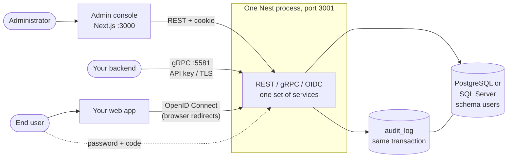

Reference docs: [grpc.md](grpc.md), [integrate.md](integrate.md), [sso.md](sso.md), [database.md](database.md).

## Choosing an integration path

Use this chart to pick between OpenID Connect (SSO) and direct gRPC calls:

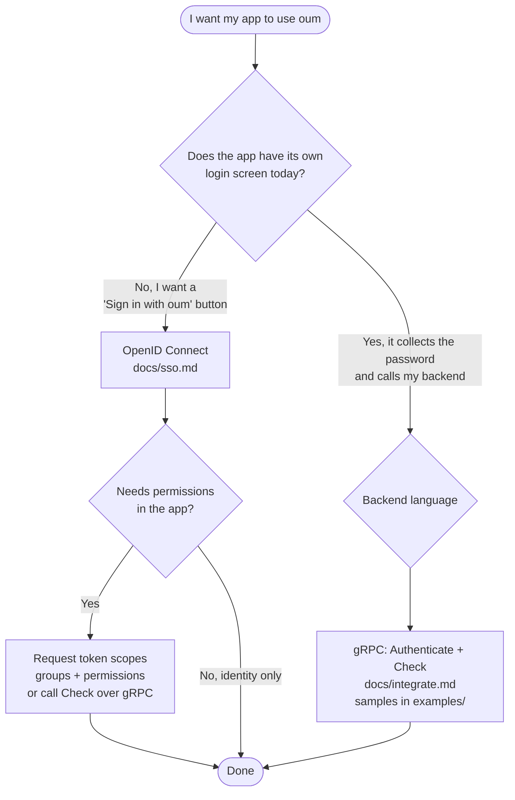

You can combine both approaches: let users sign in with SSO, and have your backend call `Check` over gRPC whenever you need fine-grained, real-time permission checks.

## First run: set oum up for your company

Complete these steps in order the first time you configure an environment. Each step builds on the previous one.

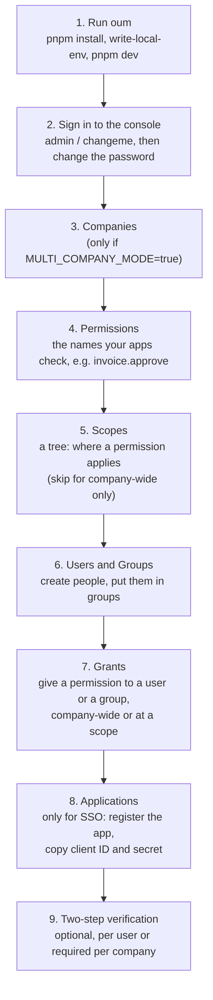

To see how these records connect to each other, read [domain.md](domain.md#how-users-and-groups-relate-to-companies-scopes-and-applications).

**Tip:** Assign grants to **groups** rather than individual users. When someone joins or leaves a team, you only update their group membership and their access updates automatically.

## How access is decided (Check)

When your backend calls `Check`, it asks whether a specific user holds a specific permission (optionally at a specific scope). `oum` replies with `allowed` (`true` or `false`) and, when allowed, returns the grant that matched so every decision is traceable.

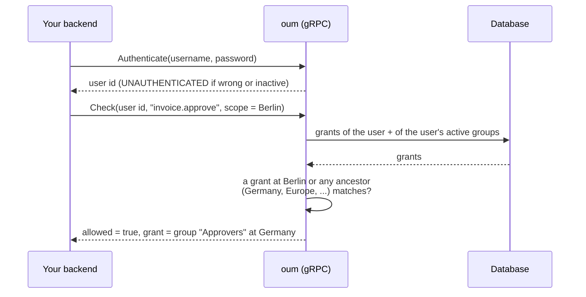

Here is the decision logic `oum` follows for every `Check`:

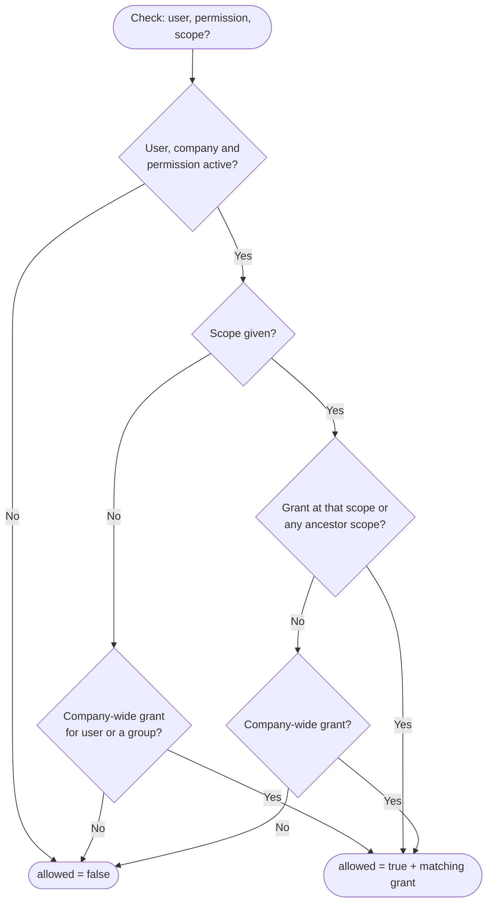

There are no deny rules; if no grant matches, access is denied. Grants inherit **down** the scope tree, never up. For the full set of domain rules, see [domain.md](domain.md).

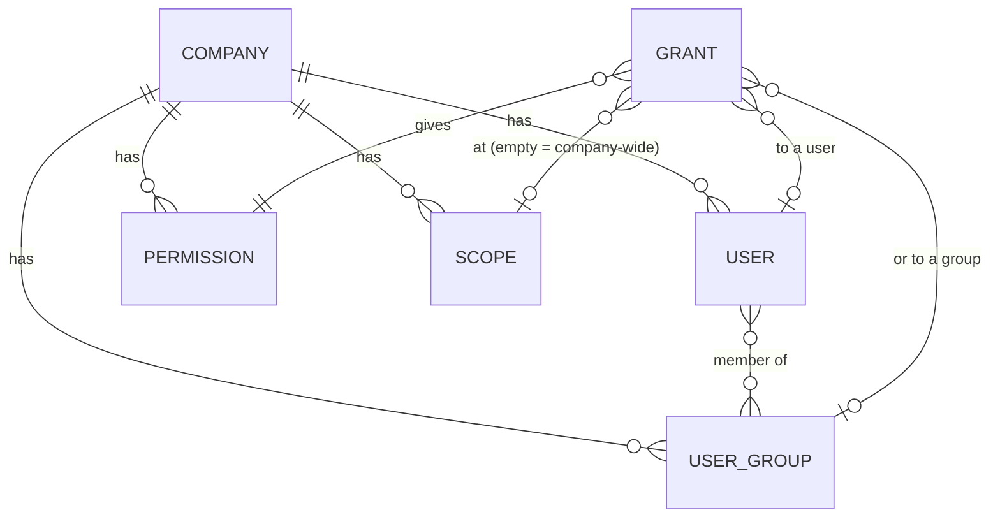

## Sign in through oum (SSO)

`oum` includes a standard OpenID Connect provider. Your application never handles the user's password: the browser redirects to `oum`'s sign-in page and returns with a one-time authorization code that your app exchanges for tokens.

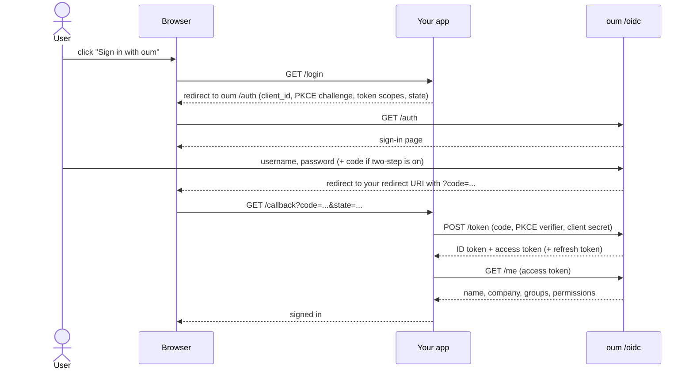

To connect an app:

1. Open **Applications** in the admin console, register your app with its redirect URI, and save the client ID and client secret (the secret is shown only once).
2. Configure your OpenID client library with the issuer URL, client ID, client secret, PKCE enabled, and the token scopes `openid profile email groups permissions`.
3. Read `groups` and `permissions` from the userinfo endpoint (`/me`), or call `Check` over gRPC from your backend.

For the full settings table, a Next.js (Auth.js) example, and troubleshooting tips, see [sso.md](sso.md).

## What happens at the sign-in page

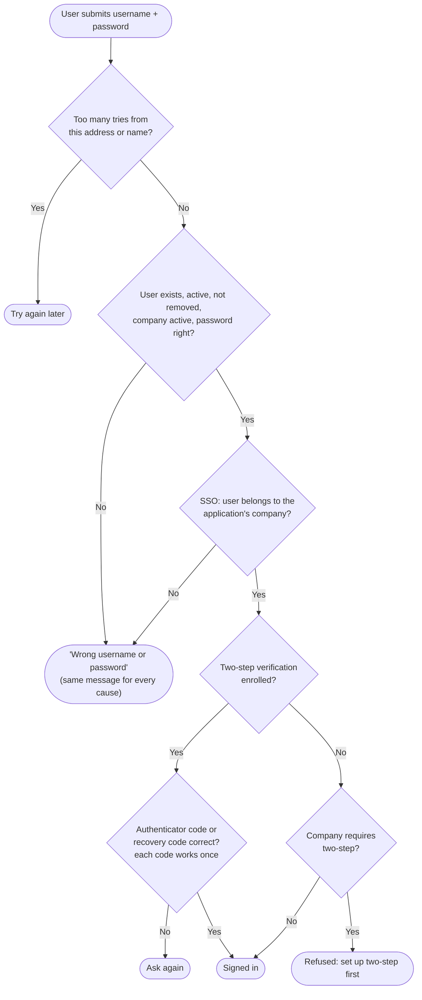

## Two-step verification

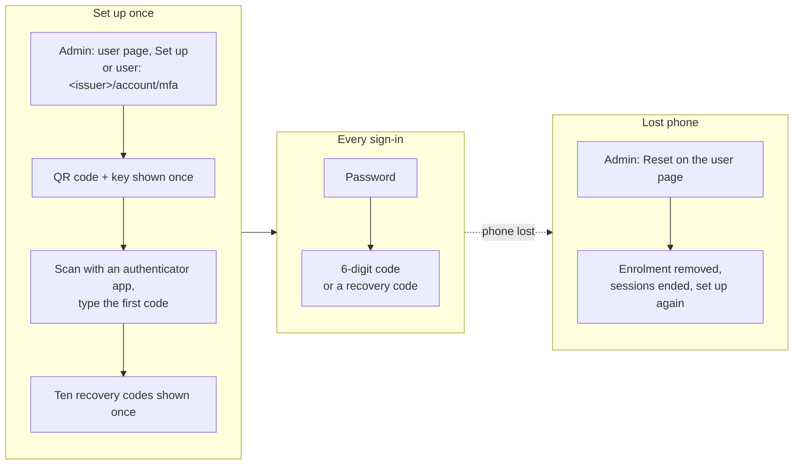

Two-step verification requires `TOTP_ENCRYPTION_KEY` (32 or more random characters) in the API environment. Do not change this key after users have enrolled, or their existing secrets can no longer be decrypted. See [sso.md](sso.md#two-step-verification-totp) for setup details and self-service security considerations.

## Changing and removing records

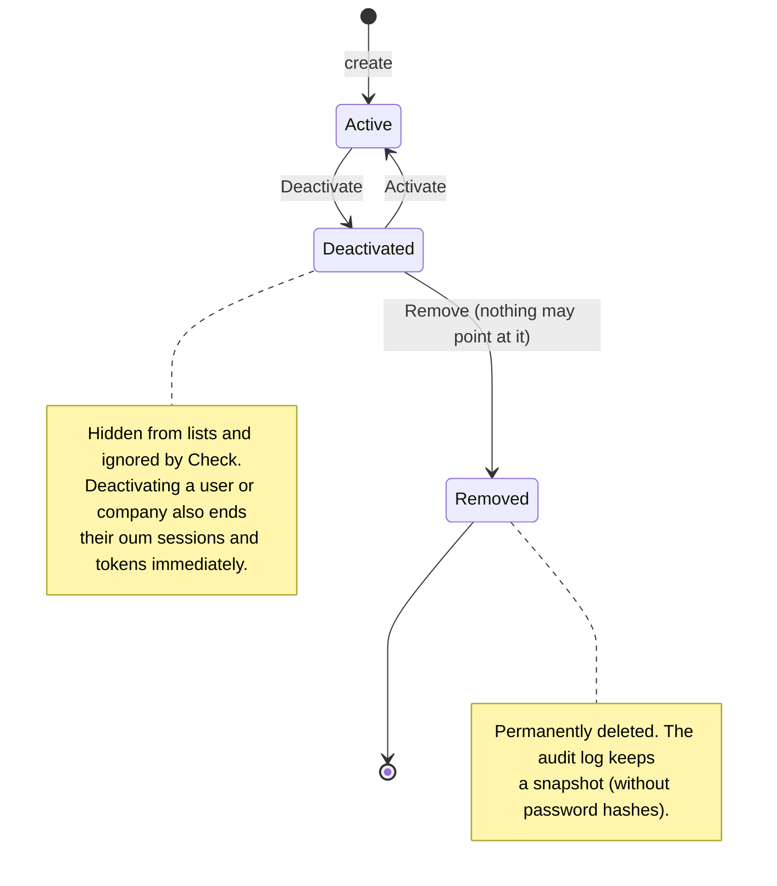

Every update, deactivation, activation, and removal is written to `users.audit_log` in the same transaction, recording who made the change, what changed, and whether it came from REST or gRPC.

## Where oum runs

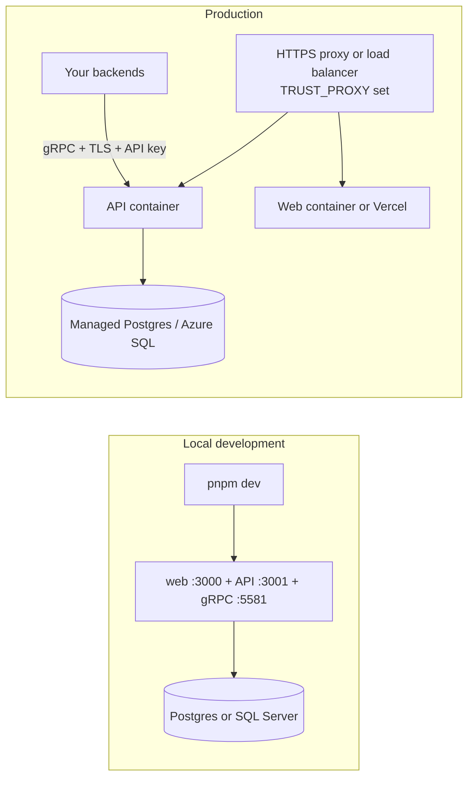

For Docker Compose, cloud, and Vercel instructions, see [deploy.md](deploy.md). For all environment variables, see [environment.md](environment.md).

## Pre-launch checklist

- [ ] Change the seeded `admin` password and set a strong `JWT_SECRET`.
- [ ] Enable gRPC TLS and set `GRPC_API_KEY`.
- [ ] Set `OIDC_ISSUER` to your public `https://` URL **including `/oidc`**, and configure `TRUST_PROXY` when running behind a proxy or load balancer.
- [ ] Back up `TOTP_ENCRYPTION_KEY` and your OIDC signing key securely.
- [ ] Assign permissions to groups rather than individual users, and create a second administrator account in case one loses their authenticator device.
